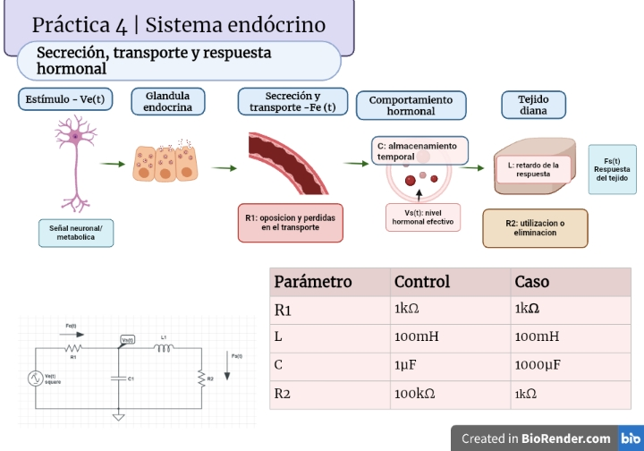
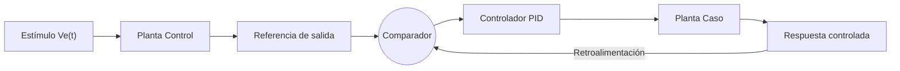
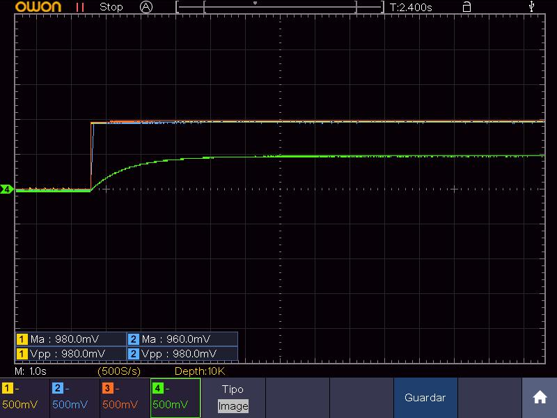
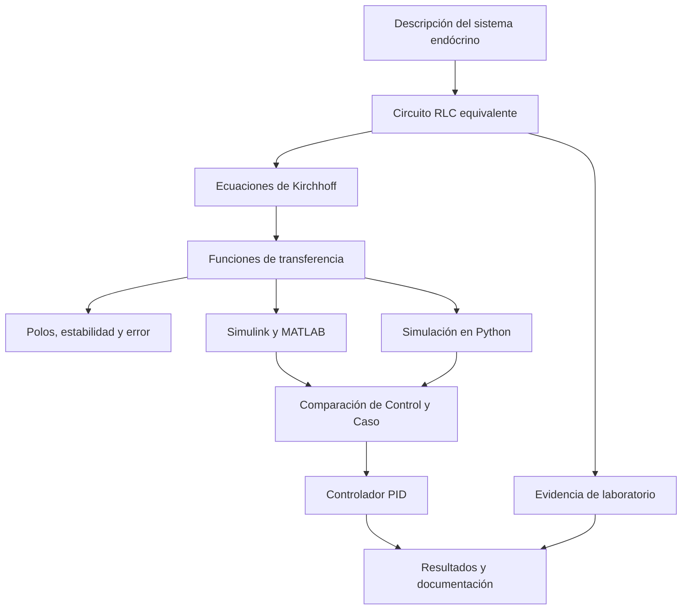

[https://github.com/l23212184-ship-it](https://github.com/l23212184-ship-it)
# Práctica 4 — Modelado y control del sistema endócrino

Repositorio académico de la asignatura **Modelado de Sistemas Fisiológicos**, correspondiente al programa de **Ingeniería Biomédica** del Tecnológico Nacional de México / Instituto Tecnológico de Tijuana. En esta práctica se estudia un modelo de segundo orden del sistema endócrino, utilizando una analogía eléctrica, funciones de transferencia, simulaciones y control PID.

El modelo representa de forma simplificada la **secreción, el transporte, el almacenamiento y la respuesta hormonal** mediante un circuito RLC con dos resistencias (`R1` y `R2`), un capacitor (`C`) y un inductor (`L`). Se comparan dos condiciones: **Control** (individuo sano) y **Caso** (condición alterada), utilizando una entrada escalón unitario.

**Docente:** Dr. Paul Antonio Valle Trujillo  
**Correo:** paul.valle@tectijuana.edu.mx  
**Departamento:** Ingeniería Eléctrica y Electrónica  
**Institución:** Tecnológico Nacional de México / Instituto Tecnológico de Tijuana  
**Asignatura:** Modelado de Sistemas Fisiológicos (IBF-1020)  
**Programa:** Ingeniería Biomédica  
**Estudiante:** **Castro Alcántar Daniel Hiram**  
**Número de control:** **23212184**  
**Correo institucional:** **l23212184@tectijuana.edu.mx**  
**Sede:** Blvd. Alberto Limón Padilla s/n, C. P. 22454, Tijuana, B. C., México.

**Repositorio de la asignatura:** [DrPaulValle/MSF-IBF1020](https://github.com/DrPaulValle/MSF-IBF1020)

## Contenido

1. [Resumen](#resumen)
2. [Competencia y objetivos](#competencia-y-objetivos)
3. [Relación con el temario](#relación-con-el-temario)
4. [Modelo físico y analogía eléctrica](#modelo-físico-y-analogía-eléctrica)
5. [Formulación matemática](#formulación-matemática)
6. [Análisis temporal y de estabilidad](#análisis-temporal-y-de-estabilidad)
7. [Señal de entrada y condiciones de simulación](#señal-de-entrada-y-condiciones-de-simulación)
8. [Implementación en MATLAB, Simulink y Simscape](#implementación-en-matlab-simulink-y-simscape)
9. [Control en lazo cerrado y sintonización PID](#control-en-lazo-cerrado-y-sintonización-pid)
10. [Reproducción en Python](#reproducción-en-python)
11. [Controlador analógico y laboratorio](#controlador-analógico-y-laboratorio)
12. [Resultados y verificación cruzada](#resultados-y-verificación-cruzada)
13. [Flujo de trabajo](#flujo-de-trabajo)
14. [Actividades del estudiante](#actividades-del-estudiante)
15. [Estructura del repositorio](#estructura-del-repositorio)
16. [Requisitos](#requisitos)

---

## Resumen

La práctica tiene como objetivo representar el comportamiento dinámico de un sistema endócrino por medio de una analogía eléctrica de segundo orden. Se parte de los procesos de secreción y transporte de una señal hormonal hasta su almacenamiento y efecto en un tejido diana. A partir del circuito equivalente se formulan las ecuaciones de Kirchhoff y se obtiene la función de transferencia que relaciona la señal de entrada con la respuesta del sistema.

Se analizan dos conjuntos de parámetros. La condición **Control** utiliza valores que permiten una salida final cercana a la entrada, mientras que la condición **Caso** modifica el capacitor y la resistencia de salida, produciendo una respuesta más lenta y una reducción del valor final. Se comparan las simulaciones de MATLAB/Simulink y Python y se incorpora el controlador PID del programa Python, que utiliza como referencia la respuesta del sistema Control. Se adjuntan el análisis matemático, los archivos de simulación y una captura del osciloscopio.

**Palabras clave:** sistema endócrino; analogía eléctrica; circuito RLC; función de transferencia; estabilidad; control PID; MATLAB; Simulink; Python.

[Volver al contenido](#contenido)

## Competencia y objetivos

### Competencia a desarrollar

Modelar sistemas fisiológicos mediante analogías eléctricas, ecuaciones diferenciales y funciones de transferencia; analizar su respuesta temporal y aplicar herramientas de control clásico para comparar una condición de referencia con una condición alterada.

### Objetivo general

Analizar el modelo de segundo orden del sistema endócrino bajo las condiciones **Control** y **Caso** y evaluar mediante MATLAB, Simulink y Python una estrategia de control PID que reduzca la diferencia respecto de la respuesta de referencia.

### Objetivos específicos

- Representar la secreción, el transporte, el almacenamiento y la respuesta hormonal con un circuito equivalente.
- Obtener las ecuaciones integro-diferenciales y la función de transferencia.
- Calcular los polos, la estabilidad y el error estacionario en cada condición.
- Comparar las respuestas de las dos condiciones ante un escalón unitario.
- Documentar las simulaciones, el BioRender y la evidencia de laboratorio.

[Volver al contenido](#contenido)

## Relación con el temario

La práctica integra las tres primeras unidades de **Modelado de Sistemas Fisiológicos (IBF-1020)**:

| Unidad | Área | Contenidos aplicados |
|---|---|---|
| I | Sistemas de control retroalimentados | Respuesta temporal, estabilidad, error y lazo cerrado. |
| II | Modelado matemático | Circuito equivalente, leyes de Kirchhoff y función de transferencia. |
| III | Controladores | PID y comparación de la respuesta del caso con la referencia. |

[Volver al contenido](#contenido)

## Modelo físico y analogía eléctrica

### Representación fisiológica en BioRender

El siguiente diagrama representa la secuencia del estímulo, la glándula endócrina, el transporte de la hormona y la respuesta del tejido diana. Debajo se muestra la analogía eléctrica utilizada en la práctica.



### Correspondencia entre el sistema endócrino y el circuito

| Elemento | Interpretación dentro del modelo |
|---|---|
| Ve(t) | Estímulo o señal de entrada. |
| Fe(t) | Flujo equivalente de secreción y transporte hormonal. |
| R1 | Oposición y pérdidas durante el transporte. |
| C | Almacenamiento temporal de la señal hormonal. |
| L | Retardo o inercia en la respuesta del tejido diana. |
| R2 | Utilización, disipación o eliminación de la señal. |
| Fs(t) | Flujo equivalente asociado con la respuesta del tejido. |
| Vs(t) | Señal hormonal efectiva de salida. |

Esta correspondencia es una **analogía didáctica**, no una medición directa de concentraciones hormonales.

### Topología del circuito

La fuente de entrada `Ve(t)` se conecta en serie con `R1`. Después de esta resistencia hay un nodo conectado al capacitor `C` hacia tierra y, en otra rama, al inductor `L` seguido de `R2` hacia tierra. La salida `Vs(t)` se mide en ese nodo común.

### Parámetros: Control y Caso

| Componente | Control (individuo sano) | Caso (condición alterada) |
|---|---:|---:|
| R1 | 1 kΩ | 1 kΩ |
| L | 100 mH | 100 mH |
| C | 1 µF | 1000 µF |
| R2 | 100 kΩ | 1 kΩ |

[Volver al contenido](#contenido)

## Formulación matemática

### 1. Ecuaciones del circuito

Utilizando la ley de corrientes de Kirchhoff y las relaciones de los componentes eléctricos:

$$
F_e(t)=C\frac{dV_s(t)}{dt}+F_s(t)
$$

La caída de tensión en la resistencia `R1` es:

$$
V_e(t)-V_s(t)=R_1F_e(t)
$$

Para la rama del inductor y la resistencia `R2`:

$$
V_s(t)=L\frac{dF_s(t)}{dt}+R_2F_s(t)
$$

Estas tres expresiones describen el balance de la señal de entrada, el almacenamiento y la respuesta de salida. El procedimiento manuscrito está disponible en [Análisis matemático (PDF)](Analisis_matematico.pdf).

### 2. Transformada de Laplace

Con condiciones iniciales nulas:

$$
F_e(s)=CsV_s(s)+F_s(s)
$$

$$
V_e(s)-V_s(s)=R_1F_e(s)
$$

$$
V_s(s)=(Ls+R_2)F_s(s)
$$

De la tercera ecuación:

$$
F_s(s)=\frac{V_s(s)}{Ls+R_2}
$$

Al sustituirla en el balance de corrientes y después en la ecuación de entrada:

$$
V_e(s)=V_s(s)\left(1+R_1Cs+\frac{R_1}{Ls+R_2}\right)
$$

### 3. Función de transferencia general

La función de transferencia del sistema, que relaciona la salida con la entrada, es:

$$
G(s)=\frac{V_s(s)}{V_e(s)}=\frac{Ls+R_2}{CLR_1s^2+(CR_1R_2+L)s+(R_1+R_2)}
$$

El sistema es **de segundo orden** porque el capacitor y el inductor almacenan energía de forma independiente.

### 4. Funciones de transferencia de cada condición

**Control:** con `R1 = 1000 Ω`, `R2 = 100000 Ω`, `L = 0.1 H` y `C = 0.000001 F`:

$$
G_{control}(s)=\frac{0.1s+100000}{0.0001s^2+100.1s+101000}
$$

**Caso:** con `R1 = 1000 Ω`, `R2 = 1000 Ω`, `L = 0.1 H` y `C = 0.001 F`:

$$
G_{caso}(s)=\frac{0.1s+1000}{0.1s^2+1000.1s+2000}
$$

Estas funciones coinciden con las expresiones definidas en el archivo [`Castro23212184.py`](Castro23212184.py).

[Volver al contenido](#contenido)

## Análisis temporal y de estabilidad

### Condición Control

Los polos de la función de transferencia se obtienen al igualar su denominador a cero:

$$
0.0001s^2+100.1s+101000=0
$$

Sus raíces aproximadas son **−1010.0101** y **−999989.9899**. Ambas son reales y negativas, por lo tanto el sistema es **estable y sobreamortiguado**.

Para una entrada escalón unitario, la salida final y el error estacionario son:

$$
G_{control}(0)=\frac{100000}{101000}\approx 0.9901
$$

$$
e_{ss,control}=1-G_{control}(0)\approx 0.0099
$$

### Condición Caso

La ecuación característica es:

$$
0.1s^2+1000.1s+2000=0
$$

Sus raíces aproximadas son **−2.0002** y **−9998.9998**. También son reales y negativas; el sistema es **estable y sobreamortiguado**, pero tiene una dinámica mucho más lenta que la condición Control.

Para el escalón unitario:

$$
G_{caso}(0)=\frac{1000}{2000}=0.5
$$

$$
e_{ss,caso}=1-G_{caso}(0)=0.5
$$

En resumen, la salida del Control se aproxima a `0.99 V` y la del Caso a `0.50 V`. Este resultado se observa en las figuras de MATLAB y Python.

[Volver al contenido](#contenido)

## Señal de entrada y condiciones de simulación

| Parámetro | Valor utilizado |
|---|---|
| Entrada | Escalón unitario de 1 V |
| Tiempo de simulación | 0 a 10 s |
| Condiciones iniciales | Nulas |
| Paso temporal en Python | 0.001 s |
| Solver de Simulink desde el cuaderno MATLAB | `ode15s` |
| Paso máximo configurado en MATLAB | 0.001 s |

La entrada tipo escalón permite observar tanto el comportamiento transitorio como el nivel final de respuesta. En el archivo MATLAB se genera una gráfica con las señales de entrada, Control, Caso y PID.

[Volver al contenido](#contenido)

## Implementación en MATLAB, Simulink y Simscape

El modelo computacional se incluye en [`Sistema.slx`](Sistema.slx). Para ejecutarlo se utiliza el cuaderno [`Castro23212184.mlx`](Castro23212184.mlx), cuyo resultado exportado está en [`Castro23212184.pdf`](Castro23212184.pdf).

La simulación se configura con un tiempo final de 10 segundos, el solver `ode15s` y un paso máximo de `1e-3` segundos. El cuaderno recupera las señales y genera la figura comparativa de ambas condiciones y el controlador.


**Figura:** comparación generada en MATLAB. La señal de entrada y la respuesta Control permanecen cerca de 1 V; el Caso converge hacia 0.5 V.

[Gráfica original en PDF](casocontrol.matlab.pdf)

[Volver al contenido](#contenido)

## Control en lazo cerrado y sintonización PID

El objetivo del controlador es hacer que la respuesta del **Caso** se aproxime a la respuesta del **Control**. La referencia no es únicamente el escalón, sino la salida dinámica del sistema sano.

La señal de error que utiliza la estructura de control es:

$$
e(t)=V_{s,control}(t)-V_{s,PID}(t)
$$

La ley ideal del controlador PID es:

$$
u(t)=K_Pe(t)+K_I\int_0^t e(\tau)\,d\tau+K_D\frac{de(t)}{dt}
$$

En el archivo Python se utilizan las siguientes ganancias de referencia:

| Ganancia | Valor |
|---|---:|
| KP | 13209.9564 |
| KI | 32316525.9285 |
| KD | 0.18118 |

El código construye el controlador a partir de las relaciones para los componentes analógicos y cierra el lazo con retroalimentación negativa unitaria. Las ganancias de esta sección corresponden **solamente a tu archivo Python**.

### Diagrama de bloques



[Volver al contenido](#contenido)

## Reproducción en Python

El programa [`Castro23212184.py`](Castro23212184.py) calcula ambas funciones de transferencia mediante la biblioteca `control`, establece el controlador y simula la respuesta con el mismo intervalo temporal y la entrada escalón.

La gráfica compara cuatro señales: estímulo, salida Control, salida Caso y salida controlada por PID.


[Ver gráfica original de Python en PDF](Control_caso_python4.pdf)

[Volver al contenido](#contenido)

## Controlador analógico y laboratorio

El circuito eléctrico equivalente permite comparar las condiciones Control y Caso mediante componentes resistivos, inductivos y capacitivos. Para contrastar la respuesta con el modelo simulado se utiliza el generador de funciones y el osciloscopio.

Se incluye una captura del osciloscopio correspondiente a la aplicación de una señal tipo escalón. En ella se observa una respuesta prácticamente inmediata y otra con una evolución gradual, consistente de forma cualitativa con las diferencias previstas por el modelo.



Esta captura es una evidencia experimental de la práctica; no se atribuyen mediciones adicionales ni se afirma que el controlador PID analógico haya sido montado, porque no se adjuntó una evidencia específica de ese montaje.

[Volver al contenido](#contenido)

## Resultados y verificación cruzada

Las funciones de transferencia y las gráficas permiten identificar las diferencias entre el sistema de referencia y la condición alterada.

| Resultado | Control | Caso |
|---|---|---|
| Polos | −1010.0101 y −999989.9899 | −2.0002 y −9998.9998 |
| Estabilidad | Estable | Estable |
| Tipo de respuesta | Sobreamortiguada | Sobreamortiguada |
| Valor final ante escalón de 1 V | 0.9901 V | 0.5000 V |
| Error estacionario | 0.0099 V | 0.5000 V |

### Archivos de la práctica

| Evidencia | Archivo |
|---|---|
| BioRender | [Biorender.jpeg](Biorender.jpeg) |
| Análisis matemático manuscrito | [Analisis_matematico.pdf](Analisis_matematico.pdf) |
| Cuaderno MATLAB | [Castro23212184.mlx](Castro23212184.mlx) |
| Cuaderno MATLAB exportado | [Castro23212184.pdf](Castro23212184.pdf) |
| Modelo Simulink | [Sistema.slx](Sistema.slx) |
| Gráfica MATLAB | [casocontrol.matlab.pdf](casocontrol.matlab.pdf) |
| Código Python | [Castro23212184.py](Castro23212184.py) |
| Gráfica Python | [Control_caso_python4.pdf](Control_caso_python4.pdf) |
| Osciloscopio | [Laboratorio.jpg](Laboratorio.jpg) |

**Interpretación:** en el modelo alterado la respuesta se establece de forma más lenta y alcanza la mitad de la señal aplicada, mientras que el Control prácticamente conserva la amplitud del estímulo. El controlador permite aproximar la respuesta alterada a la de referencia en la simulación, según las figuras proporcionadas.

[Volver al contenido](#contenido)

## Flujo de trabajo



[Volver al contenido](#contenido)

## Actividades del estudiante

- [x] Interpretación del proceso fisiológico y esquema en BioRender.
- [x] Obtención del circuito eléctrico equivalente.
- [x] Desarrollo matemático y función de transferencia.
- [x] Análisis de polos, estabilidad y error estacionario.
- [x] Simulación mediante MATLAB/Simulink.
- [x] Reproducción de las gráficas mediante Python.
- [x] Comparación de las condiciones Control y Caso.
- [x] Inclusión de una captura de osciloscopio.
- [x] Organización de los archivos y documentación en el README.

[Volver al contenido](#contenido)

## Estructura del repositorio

Todos los archivos utilizados por los enlaces e imágenes se encuentran en la misma carpeta que el `README.md`:

```text
.
├── README.md
├── Biorender.jpeg
├── Analisis_matematico.pdf
├── Castro23212184.mlx
├── Castro23212184.pdf
├── Castro23212184.py
├── Sistema.slx
├── casocontrol.matlab.pdf
├── Control_caso_python4.pdf
├── Grafica_MATLAB.png
├── Grafica_Python.png
└── Laboratorio.jpg
```

[Volver al contenido](#contenido)

## Requisitos

- **MATLAB** y **Simulink** para abrir el cuaderno `.mlx` y el modelo `.slx`.
- **Python 3** con las bibliotecas `numpy`, `matplotlib` y `control` para ejecutar el script.
- **GitHub** para visualizar el README y conservar los archivos de la práctica.
- **Instrumental de laboratorio:** circuito equivalente, generador de funciones, osciloscopio y elementos de conexión.

**Fuente académica:** P. A. Valle Trujillo, *Syllabus para Modelado de Sistemas Fisiológicos*, Instituto Tecnológico de Tijuana, 2026, sección 5.6, pp. 96–105.

[Volver al contenido](#contenido)
