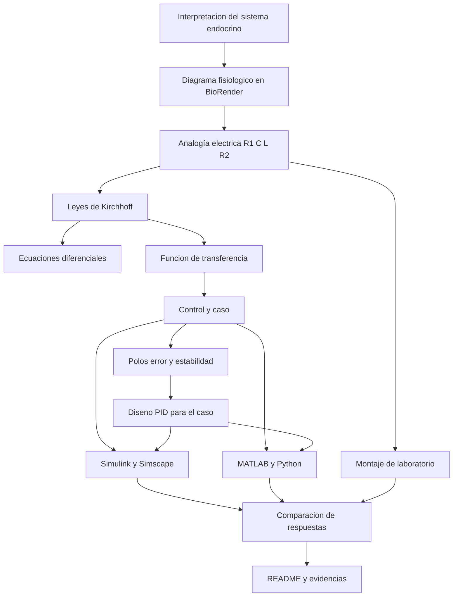

[README_Practica4_Endocrino_GitHub_FINAL.md](https://github.com/user-attachments/files/35066474/README_Practica4_Endocrino_GitHub_FINAL.md)
# Práctica 4 — Modelado y control del sistema endócrino

Repositorio académico de la asignatura **Modelado de Sistemas Fisiológicos**, correspondiente a Ingeniería Biomédica del Tecnológico Nacional de México / Instituto Tecnológico de Tijuana. Esta práctica integra la interpretación fisiológica, el modelado mediante una analogía eléctrica, el análisis de estabilidad y de error, la simulación en MATLAB y Python, el diseño de control PID y la verificación en el laboratorio.

El modelo representa de forma simplificada la **secreción, el transporte, el almacenamiento y la respuesta hormonal**. Se comparan dos condiciones, denominadas **control** y **caso**, mediante un circuito de segundo orden formado por dos resistencias, una capacitancia y una inductancia.

**Docente:** Dr. Paul Antonio Valle Trujillo  
**Correo del docente:** paul.valle@tectijuana.edu.mx  
**Departamento:** Ingeniería Eléctrica y Electrónica  
**Institución:** Tecnológico Nacional de México / Instituto Tecnológico de Tijuana  
**Asignatura:** Modelado de Sistemas Fisiológicos (IBF-1020)  
**Programa:** Ingeniería Biomédica  
**Estudiante:** Castro Alcántar Daniel Hiram  
**Número de control:** 23212184  
**Correo institucional:** l23212184@tectijuana.edu.mx  
**Fecha:** Noviembre de 2026  
**Sede:** Blvd. Alberto Limón Padilla s/n, C. P. 22454, Tijuana, B. C., México.

**Repositorio de la asignatura:** https://github.com/DrPaulValle/MSF-IBF1020  
**Instructivo empleado:** [*Syllabus para Modelado de Sistemas Fisiológicos*, sección 5.6, pp. 96–105](documentos/Syllabus_Modelado_de_Sistemas_Fisiologicos.pdf).

---

<a id="contenido"></a>
## Contenido

1. [Resumen](#resumen)
2. [Competencia y objetivos](#objetivos)
3. [Relación con el temario](#temario)
4. [Modelo físico y analogía eléctrica](#analogia)
5. [Formulación matemática](#modelo)
6. [Análisis temporal y de estabilidad](#analisis)
7. [Señal de entrada y condiciones de simulación](#senales)
8. [Implementación en MATLAB, Simulink y Simscape](#matlab)
9. [Control en lazo cerrado y sintonización PID](#pid)
10. [Reproducción en Python](#python)
11. [Controlador analógico y laboratorio](#laboratorio)
12. [Resultados y verificación cruzada](#resultados)
13. [Flujo de trabajo](#flujo)
14. [Actividades del estudiante](#actividades)
15. [Estructura del repositorio](#estructura)
16. [Requisitos](#requisitos)
17. [Reproducibilidad y entregables](#reproducibilidad)
18. [Referencias](#referencias)

---

<a id="resumen"></a>
## Resumen

En esta práctica se estudia un sistema endócrino simplificado mediante una analogía eléctrica **R1–C–L–R2**. El estímulo hormonal se representa mediante el voltaje de entrada, el transporte mediante una resistencia, el almacenamiento mediante un capacitor y la respuesta retardada de un tejido diana mediante una rama inductiva y resistiva. Se propone y analiza un circuito **de segundo orden** con dos juegos de parámetros: control y caso.

A partir de las leyes de Kirchhoff se obtienen las ecuaciones integro-diferenciales, la función de transferencia general y la representación mediante variables de estado. Se calculan los polos de las dos condiciones y el error en estado estacionario ante un escalón unitario. Posteriormente se utiliza un controlador PID para aproximar la respuesta del caso a la referencia del control. Las simulaciones se documentan con un cuaderno MATLAB, un modelo Simulink y un programa Python; también se incorpora una captura del osciloscopio y el esquema fisiológico de BioRender.

El trabajo es una **analogía académica**, no un modelo clínico específico ni un tratamiento real para un trastorno hormonal.

**Palabras clave:** sistema endócrino; secreción hormonal; analogía eléctrica; RLC; función de transferencia; estabilidad; control PID; MATLAB; Simulink; Simscape Electrical; Python; BioRender.

[Volver al contenido](#contenido)

---

<a id="objetivos"></a>
## Competencia y objetivos

### Competencia a desarrollar

Modelar sistemas fisiológicos mediante analogías eléctricas, ecuaciones diferenciales y funciones de transferencia para analizar su comportamiento dinámico y diseñar estrategias de control basadas en técnicas de control clásico, conforme al syllabus de la asignatura.

### Objetivo general

Modelar y comparar la respuesta dinámica de las condiciones **control** y **caso** de un sistema endócrino simplificado, y evaluar la acción de un controlador PID que reduzca la diferencia respecto de la respuesta de referencia.

### Objetivos específicos

- Interpretar las etapas de secreción, transporte, almacenamiento y respuesta hormonal.
- Identificar las variables de entrada y salida, flujos y elementos del circuito equivalente.
- Obtener las ecuaciones de Kirchhoff y la función de transferencia de segundo orden.
- Calcular la estabilidad y el error estacionario de control y caso.
- Reproducir las respuestas mediante MATLAB, Simulink, Simscape Electrical y Python.
- Utilizar las ganancias del PID registradas en el código Python de esta práctica.
- Comparar las simulaciones con los resultados observados en el osciloscopio.
- Documentar el desarrollo y las evidencias en un repositorio reproducible.

[Volver al contenido](#contenido)

---

<a id="temario"></a>
## Relación con el temario

| Unidad | Tema | Aplicación en la práctica |
|---|---|---|
| I | Sistemas de control retroalimentados | Polos, estabilidad, error, transitorios y retroalimentación negativa |
| II | Modelado matemático | Analogía endócrina–eléctrica, leyes de Kirchhoff, ecuaciones diferenciales y función de transferencia |
| III | Controladores | Diseño de PID, ganancias, implementación computacional y aproximación analógica |

Se relacionan conocimientos de fisiología, circuitos eléctricos, control clásico y programación. La descripción del modelo y sus parámetros procede de la **sección 5.6** del syllabus del profesor.

[Volver al contenido](#contenido)

---

<a id="analogia"></a>
## Modelo físico y analogía eléctrica

### Interpretación fisiológica

Un estímulo neural, metabólico u homeostático desencadena la secreción de una hormona. La señal se transporta desde la glándula hacia el compartimento de respuesta; durante su tránsito puede sufrir pérdidas. Parte de la señal se acumula de forma temporal y finalmente produce una respuesta en el tejido diana, con un retardo y una disipación asociados.

### Esquema fisiológico realizado en BioRender


*Figura 1. Diagrama de BioRender de la práctica 4. Muestra el trayecto de la señal hormonal, su analogía eléctrica y la tabla de componentes para control y caso.*

### Correspondencia de variables

| Variable o componente | Representación eléctrica | Significado dentro de la analogía |
|---|---|---|
| Estímulo | $V_e(t)$ | Voltaje de entrada |
| Flujo de secreción y transporte | $F_e(t)$ | Corriente que atraviesa $R_1$ |
| Oposición durante el transporte | $R_1$ | Resistencia de la rama principal |
| Almacenamiento temporal | $C$ | Capacitor conectado del nodo principal a tierra |
| Retardo e inercia de respuesta | $L$ | Inductor de la rama del tejido diana |
| Utilización o eliminación | $R_2$ | Resistencia en serie con $L$ |
| Flujo de respuesta | $F_s(t)$ | Corriente de la rama $L$–$R_2$ |
| Nivel hormonal normalizado | $V_s(t)$ | Voltaje del nodo posterior a $R_1$ |

### Topología del circuito

La fuente $V_e(t)$ alimenta el resistor $R_1$. En el nodo situado después de $R_1$ se mide $V_s(t)$ y se conectan **dos ramas en paralelo hacia tierra**: un capacitor $C$ y la asociación **en serie** de $L$ y $R_2$. Los dos elementos de almacenamiento independientes, $C$ y $L$, determinan el orden del sistema.

### Parámetros eléctricos

| Componente | Control | Caso | Unidad |
|---|---:|---:|---|
| $R_1$ | 1 | 1 | kΩ |
| $L$ | 100 | 100 | mH |
| $C$ | **1** | **1000** | µF |
| $R_2$ | **100** | **1** | kΩ |

Para sustituir en las ecuaciones se usan unidades del Sistema Internacional:

$$
R_1=1000\;\Omega,\qquad L=0.1\;\mathrm{H}
$$

$$
C_{\mathrm{control}}=10^{-6}\;\mathrm{F},\qquad R_{2,\mathrm{control}}=100000\;\Omega
$$

$$
C_{\mathrm{caso}}=10^{-3}\;\mathrm{F},\qquad R_{2,\mathrm{caso}}=1000\;\Omega
$$

> **Alcance de la analogía:** los valores en voltios, amperios, ohmios, henrios y faradios no equivalen directamente a unidades clínicas de concentración hormonal. Se utilizan para representar matemáticamente almacenamiento, oposición, disipación y respuesta.

[Volver al contenido](#contenido)

---

<a id="modelo"></a>
## Formulación matemática

El desarrollo siguiente corresponde a la **topología indicada en el syllabus** y al procedimiento plasmado en el [análisis matemático manuscrito](documentos/Analisis_matematico.pdf). Las ecuaciones se presentan aquí directamente para que puedan leerse sin abrir el PDF.

### 1. Ley de corriente de Kirchhoff

En el nodo de salida, la corriente de entrada se distribuye entre la capacitancia y la rama formada por $L$ y $R_2$:

$$
F_e(t)=F_C(t)+F_s(t)
$$

Como la corriente del capacitor es proporcional a la derivada de su voltaje:

$$
F_C(t)=C\frac{dV_s(t)}{dt}
$$

Por consiguiente:

$$
\boxed{F_e(t)=C\frac{dV_s(t)}{dt}+F_s(t)}
$$

### 2. Ley de voltajes de Kirchhoff

La caída de voltaje sobre la resistencia de transporte $R_1$ es:

$$
\boxed{V_e(t)-V_s(t)=R_1F_e(t)}
$$

En la rama de respuesta, el inductor y la resistencia $R_2$ están conectados en serie:

$$
\boxed{V_s(t)=L\frac{dF_s(t)}{dt}+R_2F_s(t)}
$$

### 3. Formulación integro-diferencial

Bajo condiciones iniciales nulas, la tensión del capacitor puede escribirse como:

$$
V_s(t)=\frac{1}{C}\int_0^t\left[F_e(\tau)-F_s(\tau)\right]d\tau
$$

Sustituyendo en la ecuación de la resistencia de transporte:

$$
\boxed{V_e(t)=R_1F_e(t)+\frac{1}{C}\int_0^t\left[F_e(\tau)-F_s(\tau)\right]d\tau}
$$

Estas relaciones expresan el balance entre el estímulo aplicado, el almacenamiento temporal y la respuesta del tejido diana.

### 4. Obtención de la función de transferencia mediante Laplace

Considerando condiciones iniciales nulas, las tres ecuaciones del circuito se transforman a:

$$
F_e(s)=CsV_s(s)+F_s(s)
$$

$$
V_e(s)-V_s(s)=R_1F_e(s)
$$

$$
V_s(s)=(Ls+R_2)F_s(s)
$$

Despejando la corriente de la rama de respuesta:

$$
F_s(s)=\frac{V_s(s)}{Ls+R_2}
$$

Sustituyendo en el balance de corrientes:

$$
F_e(s)=CsV_s(s)+\frac{V_s(s)}{Ls+R_2}
$$

Se incorpora el resultado en la expresión del voltaje de entrada:

$$
V_e(s)-V_s(s)=R_1\left[CsV_s(s)+\frac{V_s(s)}{Ls+R_2}\right]
$$

Ahora se factoriza la salida $V_s(s)$:

$$
V_e(s)=V_s(s)\left[1+R_1Cs+\frac{R_1}{Ls+R_2}\right]
$$

Multiplicando por $Ls+R_2$:

$$
V_e(s)(Ls+R_2)=V_s(s)\left[(Ls+R_2)(1+R_1Cs)+R_1\right]
$$

El denominador desarrollado queda:

$$
(Ls+R_2)(1+R_1Cs)+R_1=CLR_1s^2+(CR_1R_2+L)s+(R_1+R_2)
$$

Por lo tanto, **la función de transferencia general del sistema endócrino** es:

$$
\boxed{G(s)=\frac{V_s(s)}{V_e(s)}=\frac{Ls+R_2}{CLR_1s^2+(CR_1R_2+L)s+(R_1+R_2)}}
$$

El denominador tiene grado dos, coherente con los dos elementos independientes de almacenamiento: **capacitancia e inductancia**.

### 5. Funciones de transferencia de control y caso

**Condición control.** Sustituyendo $R_1=1000\,\Omega$, $R_2=100000\,\Omega$, $L=0.1\,\mathrm{H}$ y $C=10^{-6}\,\mathrm{F}$:

$$
CLR_1=10^{-6}(0.1)(1000)=0.0001
$$

$$
CR_1R_2+L=10^{-6}(1000)(100000)+0.1=100.1
$$

$$
R_1+R_2=1000+100000=101000
$$

La transferencia de la condición control es:

$$
\boxed{G_{\mathrm{control}}(s)=\frac{0.1s+100000}{0.0001s^2+100.1s+101000}}
$$

**Condición caso.** Sustituyendo $R_1=1000\,\Omega$, $R_2=1000\,\Omega$, $L=0.1\,\mathrm{H}$ y $C=10^{-3}\,\mathrm{F}$:

$$
CLR_1=10^{-3}(0.1)(1000)=0.1
$$

$$
CR_1R_2+L=10^{-3}(1000)(1000)+0.1=1000.1
$$

$$
R_1+R_2=1000+1000=2000
$$

La transferencia de la condición caso es:

$$
\boxed{G_{\mathrm{caso}}(s)=\frac{0.1s+1000}{0.1s^2+1000.1s+2000}}
$$

Las dos funciones comparten la misma topología, pero la modificación de $C$ y $R_2$ cambia la ganancia estática y la velocidad de respuesta.

### 6. Ecuación diferencial de segundo orden

Multiplicando el denominador de $G(s)$ por la salida y pasando al dominio del tiempo:

$$
\boxed{CLR_1\frac{d^2V_s}{dt^2}+(CR_1R_2+L)\frac{dV_s}{dt}+(R_1+R_2)V_s=L\frac{dV_e}{dt}+R_2V_e}
$$

Esta relación ofrece una representación diferencial directa del mismo sistema que describe la analogía eléctrica.

### 7. Representación mediante ecuaciones de estado

Se seleccionan las variables asociadas con el capacitor y con el inductor:

$$
x_1(t)=V_s(t),\qquad x_2(t)=F_s(t),\qquad u(t)=V_e(t)
$$

Del balance de corrientes y de la rama de salida se obtiene:

$$
\dot{x}_1(t)=-\frac{1}{R_1C}x_1(t)-\frac{1}{C}x_2(t)+\frac{1}{R_1C}u(t)
$$

$$
\dot{x}_2(t)=\frac{1}{L}x_1(t)-\frac{R_2}{L}x_2(t)
$$

La forma matricial es:

$$
\dot{\mathbf{x}}(t)=\begin{bmatrix}-\frac{1}{R_1C}&-\frac{1}{C}\\\frac{1}{L}&-\frac{R_2}{L}\end{bmatrix}\mathbf{x}(t)+\begin{bmatrix}\frac{1}{R_1C}\\0\end{bmatrix}u(t)
$$

$$
y(t)=\begin{bmatrix}1&0\end{bmatrix}\mathbf{x}(t)=V_s(t)
$$

La misma representación puede implementarse mediante integradores, sumas y ganancias en Simulink, conservando la topología y las condiciones iniciales.

[Volver al contenido](#contenido)

---

<a id="analisis"></a>
## Análisis temporal y de estabilidad

### 1. Polos de la planta

Para una transferencia de segundo orden se utiliza el polinomio característico:

$$
D(s)=a_2s^2+a_1s+a_0
$$

Sus raíces se calculan mediante:

$$
s_{1,2}=\frac{-a_1\pm\sqrt{a_1^2-4a_2a_0}}{2a_2}
$$

Los resultados de sustituir los parámetros de cada condición son:

| Modelo | Primer polo (s⁻¹) | Segundo polo (s⁻¹) | Clasificación |
|---|---:|---:|---|
| Control | −999989.9899 | −1010.0101 | Estable y sobreamortiguado |
| Caso | −9998.9998 | −2.0002 | Estable y sobreamortiguado |

Los cuatro polos tienen parte real estrictamente negativa; por tanto, **ambas plantas son estables**. En el modelo caso aparece un polo mucho más cercano al origen, por lo que la respuesta es considerablemente más lenta.


*Figura 2. Localización de los polos calculados para el modelo control (escala del eje real ampliada).*


*Figura 3. Localización de los polos calculados para el modelo caso.*

### 2. Ganancia estática y error en estado estacionario

Para el escalón unitario de entrada $V_e(s)=1/s$, la salida final de una planta estable se obtiene con el teorema del valor final:

$$
V_s(\infty)=\lim_{s\to0}sG(s)\frac{1}{s}=G(0)=\frac{R_2}{R_1+R_2}
$$

Si el error se define como diferencia entre el escalón aplicado y la salida:

$$
e_{ss}=1-G(0)
$$

**Control:**

$$
V_{s,\mathrm{control}}(\infty)=\frac{100000}{101000}\approx0.990099\;\mathrm{V}
$$

$$
\boxed{e_{ss,\mathrm{control}}\approx0.009901\;\mathrm{V}}
$$

**Caso:**

$$
V_{s,\mathrm{caso}}(\infty)=\frac{1000}{2000}=0.5\;\mathrm{V}
$$

$$
\boxed{e_{ss,\mathrm{caso}}=0.5\;\mathrm{V}}
$$

Estos errores se refieren al **seguimiento del escalón de 1 V en lazo abierto**. Para el controlador PID, la referencia es la **respuesta del control**, por lo que el error relevante es diferente.

### 3. Respuesta temporal esperada

- El **control** se aproxima rápidamente a unos $0.99\,\mathrm{V}$ y permanece muy cerca del estímulo aplicado.
- El **caso** alcanza aproximadamente $0.50\,\mathrm{V}$, pero tarda más en llegar al régimen estacionario.
- Los polos reales negativos indican una respuesta principalmente aperiódica, sin oscilaciones sostenidas asociadas a polos complejos.
- Las diferencias se deben a los cambios simultáneos de capacitancia y resistencia $R_2$, no a una variación del estímulo aplicado.

El [PDF del análisis manuscrito](documentos/Analisis_matematico.pdf) incluye el dibujo del circuito, el procedimiento de Laplace, los cálculos de polos, los errores y bosquejos realizados durante la práctica.

[Volver al contenido](#contenido)

---

<a id="senales"></a>
## Señal de entrada y condiciones de simulación

El syllabus de la práctica endócrina establece una **entrada escalón unitario** para comparar la condición control y el caso, durante el intervalo $0\le t\le10\,\mathrm{s}$.

$$
V_e(t)=u(t)=\begin{cases}0,&t<0\\1,&t\ge0\end{cases}
$$

Las condiciones utilizadas en el cuaderno MATLAB suministrado son:

| Parámetro | Valor |
|---|---|
| Tiempo inicial | 0 s |
| Tiempo final | 10 s |
| Solver en MATLAB/Simulink | `ode15s` |
| Paso máximo en MATLAB/Simulink | `1e-3` s |
| Vector temporal de Python | 0 a 10 s |
| Separación temporal de Python | 0.001 s |
| Entrada en Python | `np.ones(N)` |

La elección de `ode15s` es adecuada para explorar modelos con escalas temporales muy diferentes, aunque la precisión de transitorios rápidos depende de los ajustes numéricos y de los datos guardados.

[Volver al contenido](#contenido)

---

<a id="matlab"></a>
## Implementación en MATLAB, Simulink y Simscape

El modelo puede representarse en tres niveles equivalentes, de acuerdo con el instructivo.

| Implementación | Descripción | Elementos a comparar |
|---|---|---|
| Ecuaciones en Simulink | Integradores, ganancias y sumadores para $V_s$ y $F_s$ | Respuesta temporal |
| Función de transferencia en Simulink | Bloques con $G_{\mathrm{control}}(s)$ y $G_{\mathrm{caso}}(s)$ | Concordancia entrada–salida |
| Circuito en Simscape Electrical | Fuente, $R_1$, $C$, $L$, $R_2$, tierra y sensores | Correspondencia de la analogía eléctrica |

### Archivos originales de MATLAB

- [Modelo Simulink: `Sistema.slx`](codigo/Sistema.slx).
- [Cuaderno computacional: `Castro23212184.mlx`](codigo/Castro23212184.mlx).
- [Exportación del cuaderno: `Castro23212184.pdf`](documentos/Castro23212184.pdf).
- [Resultado MATLAB: `casocontrol.matlab.pdf`](documentos/casocontrol.matlab.pdf).

El cuaderno registra la ejecución del modelo `Sistema` con tiempo final de 10 s y la obtención de las señales de entrada, control, caso y respuesta PID. Las gráficas se exportaron a PDF para su comparación y documentación.

### Resultado de MATLAB


*Figura 4. Comparación de las trayectorias en la simulación de MATLAB. La curva del caso tiende aproximadamente a 0.5 V; la referencia de control y la respuesta con PID se encuentran cerca de 1 V.*

[Ver el resultado original en PDF](documentos/casocontrol.matlab.pdf).

[Volver al contenido](#contenido)

---

<a id="pid"></a>
## Control en lazo cerrado y sintonización PID

### 1. Referencia y señal de error

La respuesta del modelo control funciona como referencia deseada. La señal que se desea reducir es la diferencia entre la salida del control y la salida del caso:

$$
\boxed{e(t)=V_{s,\mathrm{control}}(t)-V_{s,\mathrm{caso}}(t)}
$$

Se incorpora un controlador de tipo PID y retroalimentación negativa para mejorar el seguimiento del modelo alterado.

### 2. Ley del controlador

El controlador PID ideal se representa mediante:

$$
u_c(t)=k_Pe(t)+k_I\int_0^t e(\tau)d\tau+k_D\frac{de(t)}{dt}
$$

En el dominio de Laplace:

$$
K(s)=k_P+\frac{k_I}{s}+k_Ds
$$

### 3. Ganancias empleadas en el código Python

Para este reporte se registran **únicamente los valores incluidos en el archivo Python entregado**:

| Parámetro | Valor |
|---|---:|
| Ganancia proporcional $k_P$ | **13209.9564** |
| Ganancia integral $k_I$ | **32316525.9285** |
| Ganancia derivativa $k_D$ | **0.18118** |

La planta que se controla es la del **caso**. Con retroalimentación negativa unitaria, la transferencia de referencia a salida es:

$$
\boxed{T(s)=\frac{K(s)G_{\mathrm{caso}}(s)}{1+K(s)G_{\mathrm{caso}}(s)}}
$$

El archivo Python implementa el controlador por medio de un modelo racional construido con resistencias y capacitores calculados a partir de las ganancias anteriores. En ese mismo archivo, la respuesta del **control** se utiliza como entrada de referencia para el sistema con PID.

### 4. Interpretación del control

Sin controlador, la salida del caso se aproxima a 0.5 V. Con el PID, la respuesta calculada se aproxima a la trayectoria de referencia del control, situada alrededor de 0.99 V. El objetivo no es que el modelo simule un fármaco concreto, sino demostrar la reducción del error de seguimiento mediante control clásico.

[Volver al contenido](#contenido)

---

<a id="python"></a>
## Reproducción en Python

El archivo [`Castro23212184.py`](codigo/Castro23212184.py) implementa las funciones de transferencia de control y caso utilizando `python-control` y genera la gráfica comparativa.

### Herramientas y bibliotecas

Se emplean `numpy`, `math`, `control` y `matplotlib`. Las dependencias necesarias para reproducir el programa se incluyen en [`requirements.txt`](requirements.txt).

### Fragmento de construcción de las plantas

```python
def sis(C, R2, nombre):
    R1, L = 1E3, 100E-3
    num = [L, R2]
    den = [C*L*R1, C*R1*R2 + L, R1 + R2]
    sys = ctrl.tf(num, den)
    print(f"Función de transferencia {nombre}: {sys}\n")
    return sys

sysControl = sis(1E-6, 100E3, "Control")
sysCaso = sis(1000E-6, 1E3, "Caso")
```

### Fragmento del controlador en Python

```python
kP, kI, kD = 13209.9564, 32316525.9285, 0.18118
Cr = 1E-6
Re = 1 / (Cr*kI)
Rr = kP*Re
Ce = kD/Rr

numPID = [Re*Rr*Ce*Cr, Re*Ce + Rr*Cr, 1]
denPID = [Re*Cr, 0]
PID = ctrl.tf(numPID, denPID)
sysPID = ctrl.feedback(ctrl.series(PID, sysCaso), 1, sign=-1)
```

El programa genera la respuesta con `forced_response` y utiliza la respuesta del control como referencia de la planta controlada. El archivo original conserva el resto del procesamiento, la gráfica y la exportación.


*Figura 5. Resultado de Python: el caso alcanza alrededor de 0.5 V, mientras que el sistema controlado sigue de cerca la trayectoria del control.*

[Ver la gráfica original de Python en PDF](documentos/Control_caso_python4.pdf).

[Volver al contenido](#contenido)

---

<a id="laboratorio"></a>
## Controlador analógico y laboratorio

### 1. Valores del controlador equivalente calculados en Python

El programa parte de un capacitor de referencia $C_r=1\,\mu\mathrm{F}$ y calcula las magnitudes siguientes:

$$
R_e=\frac{1}{C_rk_I}\approx0.030944\;\Omega
$$

$$
R_r=k_PR_e\approx408.768\;\Omega
$$

$$
C_e=\frac{k_D}{R_r}\approx443.234\;\mu\mathrm{F}
$$

La forma racional programada para el controlador es:

$$
K_{\mathrm{codigo}}(s)=\frac{R_eR_rC_eC_rs^2+(R_eC_e+R_rC_r)s+1}{R_eC_rs}
$$

Estos valores son **cálculos del programa** y no deben confundirse con componentes comerciales medidos o con una construcción física demostrada. En particular, el valor calculado de $R_e$ es muy pequeño y requeriría revisar el diseño antes de realizar un PID analógico práctico. La implementación del controlador físico es una etapa distinta del análisis y la simulación.

### 2. Material y equipo

Para reproducir el circuito se requieren resistencias $R_1$ y $R_2$, el capacitor $C$, el inductor $L$, protoboard, cables, generador de funciones, osciloscopio y multímetro. El montaje de un controlador con amplificadores operacionales requiere adicionalmente una fuente adecuada y componentes elegidos según el diseño analógico.

### 3. Resultado registrado en el osciloscopio


*Figura 6. Captura de laboratorio aportada en la práctica. Se observa una señal escalón y dos respuestas con valores finales diferentes; una cercana a 1 V y otra cercana a 0.5 V. La división vertical indicada en la captura es de 500 mV.*

La respuesta que sube lentamente hacia aproximadamente $0.5\,\mathrm{V}$ es coherente con la dinámica esperada para el **caso**. La respuesta próxima a $1\,\mathrm{V}$ es coherente con el **control**. Esta comparación es **cualitativa**: la captura no aporta por sí sola una tabla de mediciones ni evidencia de todos los montajes de lazo cerrado.

### 4. Fuentes de diferencia experimental

Las diferencias entre simulación y laboratorio pueden depender de las tolerancias de resistores y capacitores, la resistencia interna del inductor, la resistencia serie equivalente del capacitor, la carga del osciloscopio, la forma de onda real del generador y las limitaciones de un circuito físico frente a los elementos ideales de la simulación.

[Volver al contenido](#contenido)

---

<a id="resultados"></a>
## Resultados y verificación cruzada

### Comparación analítica

| Magnitud | Control | Caso |
|---|---:|---:|
| $R_1$ | 1 kΩ | 1 kΩ |
| $L$ | 100 mH | 100 mH |
| $C$ | 1 µF | 1000 µF |
| $R_2$ | 100 kΩ | 1 kΩ |
| Valor final para escalón de 1 V | 0.990099 V | 0.500000 V |
| Error en lazo abierto respecto de 1 V | 0.009901 V | 0.500000 V |
| Polos | Reales negativos | Reales negativos |
| Respuesta transitoria | Rápida | Más lenta |
| Estabilidad | Estable | Estable |

### Evidencia computacional y experimental

| Evidencia | Archivo | Qué documenta |
|---|---|---|
| MATLAB | [`casocontrol.matlab.pdf`](documentos/casocontrol.matlab.pdf) | Entrada y respuestas de control, caso y PID |
| Python | [`Control_caso_python4.pdf`](documentos/Control_caso_python4.pdf) | Reproducción de las respuestas mediante código |
| Cuaderno de MATLAB | [`Castro23212184.pdf`](documentos/Castro23212184.pdf) | Configuración y salida del cuaderno computacional |
| Simulink | [`Sistema.slx`](codigo/Sistema.slx) | Modelo del sistema |
| Laboratorio | [`Laboratorio.jpg`](imagenes/Laboratorio.jpg) | Captura de las respuestas observadas en el osciloscopio |
| Análisis matemático | [`Analisis_matematico.pdf`](documentos/Analisis_matematico.pdf) | Ecuaciones, estabilidad, error y bosquejos manuscritos |
| BioRender | [`Biorender.jpeg`](imagenes/Biorender.jpeg) | Modelo fisiológico y circuito equivalente |

### Interpretación general

Las gráficas de MATLAB y Python muestran una separación clara entre las respuestas de control y caso. El modelo alterado posee un valor final menor y una evolución más lenta. Después de incorporar el PID en la simulación, la salida tratada se acerca a la referencia del control. La fotografía del osciloscopio presenta una tendencia compatible con esa distinción entre las dos plantas, sin que sea posible atribuir a la imagen un error porcentual experimental preciso.

### Desarrollo matemático manuscrito

Además del desarrollo digital anterior, se incluyen las tres hojas originales en forma de imágenes, visibles directamente en GitHub:


*Figura 7. Circuito y planteamiento de Kirchhoff.*


*Figura 8. Función de transferencia, estabilidad y error.*


*Figura 9. Error del caso y bosquejos cualitativos.*

[Descargar el análisis manuscrito completo en PDF](documentos/Analisis_matematico.pdf).

[Volver al contenido](#contenido)

---

<a id="flujo"></a>
## Flujo de trabajo



El procedimiento comienza con la descripción fisiológica y termina en la comparación entre representaciones analíticas, computacionales y experimentales.

[Volver al contenido](#contenido)

---

<a id="actividades"></a>
## Actividades del estudiante

La secuencia de trabajo de la sección 5.6.3 del syllabus se resume en las siguientes etapas:

### Formulación del modelo

- [x] Interpretar el proceso endócrino y elaborar el esquema BioRender.
- [x] Identificar la topología del circuito y los parámetros control–caso.
- [x] Formular las ecuaciones de Kirchhoff y el modelo diferencial.
- [x] Obtener la función de transferencia para control y caso.
- [x] Analizar los polos y errores estacionarios.

### Simulación y control

- [x] Incorporar archivos originales MATLAB/Simulink y Python.
- [x] Graficar entrada, control, caso y salida con PID.
- [x] Registrar las ganancias del controlador presentes en el código Python.
- [x] Documentar el cálculo del controlador equivalente.

### Laboratorio y documentación

- [x] Incorporar la captura de osciloscopio disponible.
- [x] Comparar cualitativamente las respuestas experimentales y las simulaciones.
- [x] Conservar el análisis manuscrito y la documentación académica.
- [ ] Añadir fotografías adicionales del protoboard y del controlador analógico, si se cuenta con ellas.
- [ ] Realizar una comparación cuantitativa de laboratorio si se dispone de mediciones exportadas.

Las tareas marcadas como pendientes son evidencias que **no están en los materiales proporcionados**, no afirmaciones de que no se hayan realizado.

[Volver al contenido](#contenido)

---

<a id="estructura"></a>
## Estructura del repositorio

```text
Practica4_Endocrino/
├── README.md
├── CITATION.cff
├── requirements.txt
├── codigo/
│   ├── Castro23212184.py
│   ├── Castro23212184.mlx
│   └── Sistema.slx
├── documentos/
│   ├── Analisis_matematico.pdf
│   ├── Castro23212184.pdf
│   ├── Control_caso_python4.pdf
│   ├── casocontrol.matlab.pdf
│   └── Syllabus_Modelado_de_Sistemas_Fisiologicos.pdf
└── imagenes/
    ├── Biorender.jpeg
    ├── Laboratorio.jpg
    ├── Control_caso_python4.png
    ├── casocontrol_matlab.png
    ├── Polos_control.png
    ├── Polos_caso.png
    ├── Analisis_matematico_p1.png
    ├── Analisis_matematico_p2.png
    └── Analisis_matematico_p3.png
```

**Importante para GitHub:** conservar las carpetas y sus nombres al subir la práctica. Las imágenes del BioRender y del análisis manuscrito se muestran dentro de este README porque están enlazadas con rutas relativas; los archivos PDF se encuentran vinculados para abrirlos o descargarlos.

[Volver al contenido](#contenido)

---

<a id="requisitos"></a>
## Requisitos

### Software

- **MATLAB**, **Simulink** y, para el circuito eléctrico, **Simscape Electrical**.
- Herramientas de control disponibles en MATLAB para la simulación y sintonización del PID.
- **Python 3** con `numpy`, `matplotlib` y `control`.
- Visual Studio Code u otro editor para ejecutar el archivo `.py`.
- GitHub para presentar el README y los archivos originales de la práctica.

Para instalar las dependencias principales de Python:

```bash
python -m pip install -r requirements.txt
```

### Equipo de laboratorio

Resistencias, capacitor, inductor, protoboard, cables, osciloscopio, generador de funciones y multímetro. Para un montaje analógico de PID también se requieren amplificadores operacionales, alimentación y los componentes correspondientes al diseño seleccionado.

[Volver al contenido](#contenido)

---

<a id="reproducibilidad"></a>
## Reproducibilidad y entregables

### Pasos para reproducir el análisis

1. Abrir el [syllabus](documentos/Syllabus_Modelado_de_Sistemas_Fisiologicos.pdf) en la sección 5.6 y comprobar la topología y los valores de los elementos.
2. Revisar el desarrollo matemático del apartado anterior y, si se desea, el [manuscrito](documentos/Analisis_matematico.pdf).
3. Abrir [`Sistema.slx`](codigo/Sistema.slx) y el cuaderno [`Castro23212184.mlx`](codigo/Castro23212184.mlx) en MATLAB/Simulink.
4. Ejecutar la simulación con el escalón de entrada y contrastar las respuestas control–caso.
5. Ejecutar en Python [`Castro23212184.py`](codigo/Castro23212184.py) con las dependencias indicadas.
6. Comparar las gráficas con los PDF de MATLAB y Python incluidos en `documentos/`.
7. Revisar la fotografía del osciloscopio y discutir las diferencias entre medición y simulación.
8. Publicar todas las carpetas junto con el archivo `README.md` y `CITATION.cff`.

### Entregables incluidos

| Entregable | Ubicación |
|---|---|
| Reporte de práctica | `README.md` |
| Citación del repositorio | `CITATION.cff` |
| Programa Python | `codigo/Castro23212184.py` |
| Cuaderno MATLAB | `codigo/Castro23212184.mlx` |
| Modelo Simulink | `codigo/Sistema.slx` |
| Resultados MATLAB y Python | `documentos/*.pdf` |
| BioRender y capturas | `imagenes/` |
| Análisis manuscrito | `documentos/Analisis_matematico.pdf` |

### Conclusión

La práctica permitió relacionar un proceso fisiológico simplificado con un circuito eléctrico y comprobar cómo los parámetros de almacenamiento y disipación modifican su respuesta. El control presentó una respuesta rápida y cercana al escalón de entrada, mientras que el caso respondió más lentamente y alcanzó un nivel menor. El controlador PID calculado en Python consiguió aproximar la respuesta del caso a la trayectoria de control en la simulación. Las ecuaciones, los resultados computacionales y la captura de laboratorio permiten interpretar de forma conjunta el comportamiento del modelo, considerando las limitaciones de la analogía.

[Volver al contenido](#contenido)

---

<a id="referencias"></a>
## Referencias

[1] P. A. Valle, *Syllabus para Modelado de Sistemas Fisiológicos*, Tecnológico Nacional de México / Instituto Tecnológico de Tijuana, 2026, sección 5.6, pp. 96–105. [Documento de la asignatura](documentos/Syllabus_Modelado_de_Sistemas_Fisiologicos.pdf).

[2] M. C. K. Khoo, *Physiological Control Systems: Analysis, Simulation, and Estimation*, 2nd ed., IEEE Press, 2018.

[3] F. C. Hoppensteadt y C. S. Peskin, *Modeling and Simulation in Medicine and the Life Sciences*, Springer.

[4] J. E. Hall, *Guyton and Hall Textbook of Medical Physiology*, 14th ed., Elsevier, 2021.

[5] K. Ogata, *Ingeniería de Control Moderna*, 5.ª ed., Pearson Educación, 2010.

[6] N. S. Nise, *Control Systems Engineering*, 8th ed., John Wiley & Sons, 2020.

[7] Tecnológico Nacional de México, *Programa de estudio de la asignatura Modelado de Sistemas Fisiológicos (IBF-1020)*.

---

## Uso académico

Este repositorio documenta la **Práctica 4 — Modelado y control del sistema endócrino** de la asignatura Modelado de Sistemas Fisiológicos. Su propósito es académico: analizar una analogía física simplificada y comparar sus representaciones matemáticas, computacionales y experimentales. No representa un protocolo médico ni una intervención clínica.

**Autor:** Castro Alcántar Daniel Hiram · 23212184 · Ingeniería Biomédica · Instituto Tecnológico de Tijuana.
